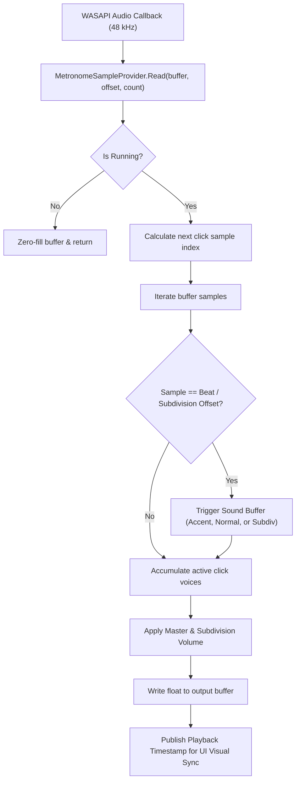

# Aukronome: Audio Engine & Architecture Deep Dive

This document details the internal architecture, timing algorithms, sound synthesis models, and thread-synchronization mechanisms powering **Aukronome**.

---

## 1. High-Level Architecture Overview

Aukronome is divided into two primary layers to strictly decouple audio rendering from the presentation framework:

```
┌─────────────────────────────────────────────────────────────┐
│                     Aukronome.App (WPF)                     │
│  - MainWindow.xaml (RawBlock Brutalist UI)                  │
│  - MainViewModel / BeatDotViewModel (MVVM Toolkit)          │
│  - CompositionTarget.Rendering (Latency-Compensated Sync)   │
└──────────────────────────────┬──────────────────────────────┘
                               │ Thread-Safe Parameter Dispatch
                               ▼
┌─────────────────────────────────────────────────────────────┐
│                    Aukronome.Core (.NET 8)                  │
│  - MetronomeAudioEngine (WASAPI Shared Mode Host)           │
│  - MetronomeSampleProvider (Sample-Accurate Audio Mixer)     │
│  - SoundSynthesizer (Algorithmic C# Waveform Generator)     │
│  - TapTempoCalculator (Adaptive Rolling Interval Filter)    │
│  - StorageService (JSON AppData Persistence)                │
└──────────────────────────────┬──────────────────────────────┘
                               │ 32-bit Float Audio Stream (48 kHz)
                               ▼
┌─────────────────────────────────────────────────────────────┐
│               Windows Audio Session API (WASAPI)            │
│               Default System Audio Output Device            │
└─────────────────────────────────────────────────────────────┘
```

---

## 2. Why Sample-Accurate Timing Matters

### The Timer Jitter Problem
Standard software metronomes commonly rely on system timers (such as `System.Timers.Timer`, `DispatcherTimer`, or `Thread.Sleep`). On desktop operating systems, these timers introduce unacceptable timing jitter:
- **OS Thread Scheduling:** Windows is a non-real-time OS; thread preemption regularly delays timer callbacks by 5–25 ms.
- **Garbage Collection (GC) Pauses:** .NET GC cycles can intermittently stall threads for several milliseconds.
- **Buffer Boundary Alignment:** Timer callbacks deliver audio on arbitrary buffer boundaries, leading to cumulative drift or audible micro-stutters.

### The Sample-Offset Solution
Aukronome implements `NAudio.Wave.ISampleProvider` inside [`MetronomeSampleProvider`](file:///d:/work/Aukronome/src/Aukronome.Core/Audio/MetronomeSampleProvider.cs).

Instead of triggering sounds via timers, clicks are mixed directly into the continuous audio stream at calculated integer **sample offsets**:

$$\text{SamplesPerBeat} = \frac{\text{SampleRate} \times 60}{\text{BPM}} \times \frac{4}{\text{Denominator}}$$

When the audio hardware requests the next buffer of audio samples (e.g., 480 samples in a 10 ms cycle), `MetronomeSampleProvider` writes the exact waveform floats into the exact index of the buffer where the beat falls.

Timing is mathematical, constant, and completely immune to CPU spikes, GC pauses, or UI thread delays.

---

## 3. Audio Thread Pipeline



---

## 4. Algorithmic Sound Synthesis

All sounds in Aukronome are synthesized mathematically in code via [`SoundSynthesizer`](file:///d:/work/Aukronome/src/Aukronome.Core/Audio/SoundSynthesizer.cs). No external audio files or WAV samples are loaded, ensuring zero disk I/O latency and negligible memory footprint.

Each sound profile renders into three pre-calculated audio float buffers upon selection:
- **`Accent` Voice:** Higher fundamental frequency and elevated gain.
- **`Normal` Voice:** Standard beat pitch and amplitude.
- **`Subdivision` Voice:** Softer, higher-frequency transient designed to sit clearly behind primary beats.

### Sound Models
1. **Click:** Exponentially decaying sinusoidal transient ($f \approx 2500\text{ Hz} \to 800\text{ Hz}$) with high-pass filtered noise burst for an ultra-sharp attack.
2. **Beep:** Pure sine wave oscillator ($f \approx 1760\text{ Hz} \text{ [A6]}$ for accents, $880\text{ Hz} \text{ [A5]}$ for beats) with a smooth 15 ms linear decay envelope.
3. **Woodblock:** Double-sine modal synthesis ($f_1 = 800\text{ Hz}, f_2 = 1250\text{ Hz}$) combined with a bandpass-filtered noise attack to simulate resonant hardwood percussion.
4. **Cowbell:** Dual square-wave ring modulation ($f_1 = 587\text{ Hz}, f_2 = 845\text{ Hz}$) shaped through a bandpass filter with sharp exponential decay, modeled after classic analog drum machines.
5. **Hi-Hat:** 6-operator square wave cluster with dense inharmonic intervals, shaped by a 7 kHz high-pass filter and rapid decay envelope.
6. **Mechanical (Classic):** Authentic acoustic pendulum metronome modeled after original Mälzel/Wittner clockwork mechanisms. Features an escapement pallet strike transient, hollow wooden pyramid body resonances ( = 440	ext{ Hz}$,  = 1160	ext{ Hz}$), and a dedicated mechanical brass bell chime ( = 2093	ext{ Hz}$,  = 4186	ext{ Hz}$,  = 5920	ext{ Hz}$) on downbeats/accents.

---

## 5. Visual Latency Compensation

A major challenge in audio applications is synchronization between the physical sound coming out of the speakers and the on-screen visual flash.

- Audio delivered to WASAPI sits in a hardware playback buffer (typically 30–50 ms in shared mode).
- If the UI flashes immediately when samples are written to the buffer, the light will flash **before** the user hears the sound.

### How Aukronome Solves This:
1. `MetronomeSampleProvider` tracks total samples written and device latency reports.
2. The UI subscribes to `CompositionTarget.Rendering` (WPF's vsync refresh callback).
3. On every frame, the current heard playback position is compared against the scheduled beat timestamps:
   $$\text{CurrentSampleTime} = \text{TotalSamplesWritten} - \text{DeviceBufferLatencySamples}$$
4. Beat indicator blocks invert to solid black precisely when the acoustic wave leaves the speaker cones.

---

## 6. Tap Tempo Mathematics

The [`TapTempoCalculator`](file:///d:/work/Aukronome/src/Aukronome.Core/Services/TapTempoCalculator.cs) converts human keystrokes or button clicks into a stable BPM readout:
- **Rolling Average:** Tracks the intervals between the last 4 consecutive taps.
- **Outlier Rejection:** Discards sudden timing outliers outside reasonable musical bounds ($1 \le \text{BPM} \le 400$).
- **Adaptive Timeout:** Resets the tap sequence after an idle duration calculated as:
  $$\text{Timeout} = \max(2.0\text{ s}, 1.5 \times \text{LastInterval})$$
  This allows slow tempos (e.g. 30 BPM, where beats occur every 2 seconds) to register naturally without prematurely resetting.

---

## 7. Thread Safety & Parameter Updates

Aukronome runs on two primary threads:
- **UI Thread:** Handles user interaction, WPF rendering, keyboard hooks, and preset management.
- **Audio Thread:** High-priority WASAPI audio rendering callback running in NAudio.

### Lock-Free Snapshot State Swapping
To guarantee zero audio dropouts, the audio thread **never acquires locks** or waits for the UI thread. Parameter changes (BPM, Accents, Time Signature) are bundled into immutable structs/snapshots and exchanged atomically:
- **BPM Changes:** Take effect immediately on the next beat onset.
- **Time Signature & Subdivision Changes:** Queued and cleanly swapped on the **next bar line** to avoid rhythmic stuttering mid-measure.
- **Accents:** Updated immediately on the active measure without interrupting the running clock.
